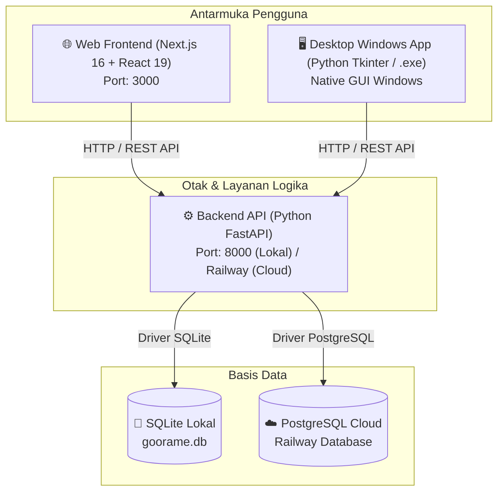

# 📘 Panduan Lengkap Goorame: Web, Backend & Desktop App (Universal untuk Pemula)

Selamat datang di panduan resmi **Goorame**! Dokumen ini dirancang khusus agar siapa pun — baik pemula yang baru pertama kali membuka **Visual Studio Code (VS Code)** di komputer mana pun maupun pengembang — dapat memahami, menginstal, menjalankan, dan membangun seluruh ekosistem aplikasi **Goorame** dari awal secara universal dan mudah.

---

## 🧭 1. Arsitektur & Komponen Ekosistem Goorame

Aplikasi **Goorame** adalah sistem Mini-ERP budidaya ikan gurame yang terintegrasi dengan akuntansi double-entry standar. Ekosistem ini terdiri dari 3 pilar utama:



1. **🌐 Web Frontend**: Dibuat menggunakan **Next.js 16 (Turbopack)**, **React 19**, dan **Tailwind CSS**. Tampilan bergaya modern *glassmorphism* yang dapat dibuka lewat browser di laptop, tablet, maupun smartphone.
2. **⚙️ Backend API**: Dibuat menggunakan **Python FastAPI**, **SQLAlchemy ORM**, dan **Pydantic**. Mengatur kalkulasi biologis ikan (stok, estimasi biomassa, survival rate) dan aturan penjurnalan akuntansi otomatis (*auto-journaling*).
3. **🖥️ Desktop Windows App**: Dibuat menggunakan **Python Tkinter & Pillow**. Merupakan aplikasi desktop native Windows yang dapat dibungkus menjadi file executable mandiri (**`.exe`**) via PyInstaller tanpa perlu menginstal Node.js atau Python di komputer pengguna lain.
4. **☁️ Cloud Railway Hosting**: Backend dan database telah ter-deploy langsung di cloud Railway:  
   👉 **URL Live API**: `https://vivacious-cat-production-1b1669c9.up.railway.app/api`

---

## 🛠️ 2. Prasyarat Software yang Harus Terinstal di Laptop / PC

Sebelum memulai, pastikan software gratis berikut telah terpasang di komputer Windows Anda:

### 1. **Visual Studio Code (VS Code)**
- Unduh di: [https://code.visualstudio.com/](https://code.visualstudio.com/)
- *Ekstensi yang disarankan di VS Code*:
  - *Python* (oleh Microsoft)
  - *Tailwind CSS IntelliSense*
  - *ESLint*

### 2. **Node.js** (Versi 18 atau 20 LTS ke atas)
- Unduh di: [https://nodejs.org/](https://nodejs.org/) (Pilih tombol bertuliskan **LTS**).
- *Fungsi*: Diperlukan untuk menjalankan Web Frontend Next.js.
- *Verifikasi di Terminal*:
  ```powershell
  node -v
  npm -v
  ```

### 3. **Python** (Versi 3.10, 3.11, 3.12, atau 3.14)
- Unduh di: [https://www.python.org/downloads/](https://www.python.org/downloads/)
- ⚠️ **SANGAT PENTING SAAT INSTALL**: Centang kotak bertuliskan **"Add python.exe to PATH"** di bagian bawah installer sebelum mengklik tombol *Install Now*.
- *Verifikasi di Terminal*:
  ```powershell
  python --version
  ```

### 4. **Git** (Opsional)
- Unduh di: [https://git-scm.com/](https://git-scm.com/) (Jika mengunduh proyek menggunakan perintah `git clone`).

---

## 📂 3. Struktur Folder Proyek

```text
goorame/                          # Folder Utama Proyek (Root Folder)
├── app/                          # File Router & Metadata Next.js (layout.tsx, page.tsx, favicon)
├── components/goorame/           # Seluruh Komponen Antarmuka Web
│   ├── dashboard-view.tsx        # Modul 1: Dashboard Eksekutif & KPI
│   ├── kolam-view.tsx            # Modul 2: Stok Kolam & Biologis
│   ├── penjualan-view.tsx        # Modul 3: Penjualan Ikan (4110 & 1140)
│   ├── pengeluaran-view.tsx      # Modul 4: Pengeluaran & Pakan (1160/6110)
│   ├── utang-view.tsx            # Modul 5: Utang Supplier & Piutang Pelanggan
│   ├── kas-view.tsx              # Modul 6: Dompet Kas & Bank (Buku Kas)
│   ├── akuntansi-view.tsx        # Modul 7: Jurnal Umum, Buku Besar & Bagan Akun COA
│   ├── laporan-view.tsx          # Modul 8: Laporan Laba Rugi & Neraca
│   ├── modals.tsx                # Seluruh Form Pop-up Transaksi
│   └── login-view.tsx            # Layanan Autentikasi Web
├── backend/                      # Backend Python FastAPI
│   ├── app/
│   │   ├── api/                  # Endpoint Router (auth, ponds, sales, expenses, cash, accounting, reports)
│   │   ├── core/                 # Konfigurasi Database, Security & Seeder Otomatis
│   │   ├── models/               # Model Database Tabel SQLAlchemy
│   │   ├── schemas/              # Validasi Data Skema Pydantic
│   │   └── services/             # Mesin Logika Akuntansi & Jurnal Berpasangan
│   ├── requirements.txt          # Daftar Pustaka Python
│   └── run.py                    # Script Peluncur Server Backend Lokal
├── desktop/                      # Aplikasi Desktop Native Windows
│   ├── app.py                    # Kode Utama GUI Desktop (Tkinter + Pillow + REST API)
│   ├── build_exe.bat             # Script 1-Klik Pembuat File .exe Mandiri
│   └── README.md                 # Dokumentasi Khusus Desktop App
├── public/                       # Aset Gambar, Logo Resmi Goorame, & Background
│   ├── logo-goorame.png          # Logo Resmi Ikan Goorame
│   ├── favicon.ico               # Icon Windows & Browser
│   └── bg.jpg                    # Wallpaper Latar Belakang
└── doc.md                        # Panduan Komprehensif Ini
```

---

## 💻 4. Langkah Membuka Proyek di VS Code

1. Simpan atau ekstrak folder proyek **Goorame** di lokasi mana saja di komputer Anda (misalnya di folder `D:\proyek\goorame` atau di Desktop).
2. Buka aplikasi **VS Code**.
3. Klik menu **File** (pojok kiri atas) → pilih **Open Folder...**.
4. Cari dan pilih folder utama proyek **Goorame** yang baru saja Anda ekstrak/unduh, lalu klik **Select Folder**.
5. Jika muncul jendela konfirmasi *"Do you trust the authors of the files in this folder?"*, klik **Yes, I trust the authors**.

> 💡 **Tips**: Setelah folder dibuka, seluruh terminal yang Anda buka di VS Code (**Terminal** → **New Terminal**) akan secara otomatis berada langsung di folder proyek Anda.

---

## ⚙️ 5. Menjalankan Backend API (Python FastAPI)

Backend bertugas mengelola basis data, aturan auto-journaling, dan autentikasi.

### 5.1 Persiapan Awal Virtual Environment (Hanya Dilakukan Sekali saat Baru Unduh Proyek)
Buka terminal di VS Code (**Terminal** → **New Terminal**), lalu jalankan perintah berikut secara berurutan:

```powershell
# 1. Buat virtual environment Python di dalam folder backend (hanya sekali)
python -m venv backend\venv

# 2. Pasang seluruh dependensi backend yang dibutuhkan
backend\venv\Scripts\python.exe -m pip install -r backend\requirements.txt

# 3. Pasang pustaka pendukung untuk GUI Desktop dan PyInstaller
backend\venv\Scripts\python.exe -m pip install requests pillow pyinstaller
```

### 5.2 Menyalakan Server Backend Lokal
Setelah instalasi selesai, nyalakan server backend dengan perintah:

```powershell
backend\venv\Scripts\python.exe backend\run.py
```

Jika berhasil, terminal akan menampilkan teks berikut:
```text
==================================================
🚀 Goorame Mini-ERP Backend (FastAPI)
🌍 Host: 0.0.0.0:8000
📖 Swagger UI: http://127.0.0.1:8000/docs
==================================================
INFO:     Uvicorn running on http://0.0.0.0:8000 (Press CTRL+C to quit)
INFO:     Application startup complete.
```
> 💡 **Penting**: Biarkan terminal backend ini tetap menyala selama Anda menggunakan aplikasi.

---

## 🌐 6. Menjalankan Web Frontend (Next.js)

Sekarang kita jalankan antarmuka website di terminal kedua tanpa mematikan terminal backend.

### 6.1 Membuka Terminal Kedua
1. Di pojok kanan atas jendela terminal (di bawah layar VS Code), klik tanda **`+`** untuk membuat terminal baru.
2. Terminal baru ini sudah otomatis berada di root folder proyek Anda.

### 6.2 Memasang Dependensi Node.js (Hanya Sekali di Awal)
Ketik perintah berikut lalu tekan **Enter**:
```powershell
npm install
```
*(Tunggu 1–2 menit sampai proses pengunduhan paket selesai).*

### 6.3 Menyalakan Server Frontend
Ketik perintah berikut:
```powershell
npm run dev
```

Jika berhasil, terminal akan memunculkan:
```text
▲ Next.js 16.4.5 (Turbopack)
- Local:   http://localhost:3000
✓ Ready in 2.1s
```

### 6.4 Membuka Website di Browser
Buka browser favorit Anda (Google Chrome, Edge, atau Firefox), lalu buka alamat:
👉 **[http://localhost:3000](http://localhost:3000)**

---

## 🖥️ 7. Menjalankan & Membangun Desktop Windows App (Tkinter)

Aplikasi Desktop Goorame dirancang menggunakan **Python Tkinter native** yang langsung terhubung ke database cloud Railway maupun lokal.

### 7.1 Cara Menjalankan Langsung (Mode Python)
Buka terminal baru di VS Code, lalu jalankan:

```powershell
backend\venv\Scripts\python.exe desktop\app.py
```
Jendela aplikasi desktop Goorame dengan logo resmi dan tema gelap emerald modern akan langsung terbuka di layar Anda.

### 7.2 Cara Membangun File Executable Mandiri (`.exe`) untuk PC Orang Lain
Anda bisa membungkus aplikasi ini menjadi file `.exe` yang bisa dikirimkan ke komputer kasir atau pekerja tambak tanpa perlu menginstal Python maupun Node.js.

#### Langkah Cepat (Klik Ganda):
1. Buka folder `desktop\` di File Explorer Windows Anda.
2. Klik ganda file **`build_exe.bat`**.
3. Script otomatis membuatkan 2 pilihan di dalam folder `dist\`:

* 👉 **Pilihan 1: File Tunggal Mandiri (*Sangat Direkomendasikan*)**:
  ```text
  dist\Goorame-Desktop-Standalone.exe
  ```
  *(Cukup kirim **1 file tunggal** ini saja ke PC orang lain via flashdisk/WhatsApp/Drive. Bisa langsung ditaruh di Desktop dan dijalankan tanpa folder tambahan).*
* 👉 **Pilihan 2: Versi Folder Lengkap**:
  ```text
  dist\Goorame-Desktop\
  ```
  *(Jika menggunakan versi ini, wajib mengompres seluruh foldernya menjadi file `.zip` sebelum dikirim ke PC lain agar folder komponen `_internal\` tidak tertinggal).*

---

## ☁️ 8. Terkoneksi ke Cloud Backend Railway

Aplikasi Goorame sudah terpasang di cloud Railway, sehingga data tersinkronisasi secara real-time antara Web dan Desktop dari mana saja:

* **URL Live API Railway**:  
  `https://vivacious-cat-production-1b1669c9.up.railway.app/api`
* **Dokumentasi Swagger API**:  
  `https://vivacious-cat-production-1b1669c9.up.railway.app/docs`

> 💡 Di aplikasi Desktop, kolom *Server API* di layar login sudah terisi otomatis ke Railway. Anda juga bisa menggantinya ke `http://127.0.0.1:8000/api` jika ingin bekerja secara offline dengan database lokal.

---

## 🔑 9. Akun Login & Hak Akses (RBAC)

Aplikasi memiliki sistem keamanan peran ketat (*Role-Based Access Control*):

| Role / Jabatan | Username | Password | Modul yang Dapat Diakses |
| :--- | :--- | :--- | :--- |
| **Pemilik Usaha** | `pemilik` | `admin123` | **Seluruh 8 Modul**: Dashboard KPI, Stok Kolam, Penjualan, Pengeluaran, Utang/Piutang, Dompet Kas, Akuntansi & Buku Besar, serta Laporan Keuangan. |
| **Pekerja Kolam** | `pekerja` | `pekerja123` | **Khusus Operasional Kolam**: Melihat data kolam, mencatat tebar bibit, dan mencatat kematian ikan harian. Modul keuangan disembunyikan. |

---

## 📖 10. Panduan Fitur 8 Modul Lengkap

Baik di versi Web maupun Desktop, tersedia 8 modul lengkap:

### 1. 📊 Dashboard (Executive Summary)
- Menampilkan 6 metrik utama: Total Populasi (ekor), Estimasi Biomassa (kg), Total Kas & Bank (Rp), Rata-rata Survival Rate (%), Laba Bersih (Rp), dan Utang Jatuh Tempo (Rp).
- Tombol Aksi Cepat (*Quick Actions*) untuk input transaksi tanpa pindah halaman.

### 2. 🏞️ Stok Kolam & Operasional
- Data teknis kolam (Kapasitas, Stok, Dimensi, Persentase Hidup/SR).
- **Tebar Bibit**: Menambah stok ekor dan bobot ikan di kolam terpilih.
- **Catat Kematian (Mortalitas)**: Mengurangi stok ikan dan otomatis memperbarui nilai survival rate (% SR).

### 3. 🏷️ Penjualan Ikan (Auto Akun 4110 & 1140)
- **Penjualan Tunai (LUNAS)**: Otomatis mendebit akun Kas/Bank pilihan dan mengkredit akun `4110 Penjualan Ikan Gurame Konsumsi`.
- **Penjualan Kredit (TEMPO)**: Otomatis mendebit akun `1140 Piutang Usaha` dan mengkredit akun `4110`.
- Dilengkapi tombol **Ekspor CSV**.

### 4. 💸 Pengeluaran Operasional (Auto Akun 1160/1170/6110/6120)
- Pembelian Pakan pelet otomatis mendebit `1160 Persediaan Pakan Ikan` (sebagai aset persediaan, bukan langsung hangus).
- Pembelian Obat/Vitamin mendebit `1170 Persediaan Obat & Vitamin`.
- Gaji pekerja mendebit `6110 Beban Gaji & Upah`.
- Listrik/Pompa mendebit `6120 Beban Listrik, Aerator & Pompa`.
- Saldo rekening kas asal otomatis terpotong secara riil.

### 5. 💳 Utang Supplier & Piutang Usaha
- **Faktur Pemasok**: Mencatat pembelian pakan/benih secara tempo (kredit) ke pemasok (Kredit `2110 Utang Usaha Pemasok`).
- **Pelunasan Utang**: Mengurangi sisa utang dan mendebit `2110`, memotong saldo Kas/Bank.
- **Monitoring Piutang**: Memantau tagihan tempo dari restoran/pengepul.

### 6. 🏦 Dompet Kas & Rekening Bank
- Memantau saldo riil di masing-masing rekening: Bank BCA (`1110`), Bank BRI (`1120`), dan Kas Kecil (`1130`).
- **Transfer Kas**: Fitur mutasi saldo antar dompet (misal: penarikan tunai dari BCA ke Kas Kecil) dengan jurnal debit-kredit otomatis.

### 7. 📑 Akuntansi Double-Entry, Buku Besar & Bagan Akun (COA)
- **Buku Jurnal Umum**: Melihat riwayat seluruh ayat jurnal berpasangan dari setiap transaksi operasional beserta status *balance check* (Debet = Kredit).
- **📚 Buku Besar (General Ledger)**: Melihat rincian mutasi spesifik per akun akuntansi (misalnya: akun Kas di Bank BCA `1110`, Piutang Usaha `1140`, Persediaan Pakan `1160`, Utang Pemasok `2110`, Penjualan Gurame `4110`, dll). Menampilkan tanggal, no bukti referensi, uraian transaksi, debet, kredit, serta **saldo berjalan (*running balance*)** dan saldo akhir akun. Dilengkapi tombol **Unduh CSV Buku Besar**.
- **Jurnal Manual**: Form entri jurnal akuntansi manual untuk penyesuaian khusus dengan validasi keseimbangan debit-kredit otomatis.
- **COA Terstandarisasi**: Daftar hierarki 22 akun standar budidaya gurame (1110 s.d 6190) dengan tombol sinkronisasi otomatis ke Railway.

### 8. 📈 Laporan Keuangan Standar
- **Laporan Laba (Rugi)**: Menghitung Pendapatan Usaha dikurangi Beban Operasional untuk menghasilkan Laba Bersih periode berjalan.
- **Laporan Posisi Keuangan (Neraca)**: Menampilkan posisi Aset, Kewajiban (Utang), dan Ekuitas (Modal) secara seimbang.
- Tombol **Ekspor Laporan ke CSV** untuk keperluan arsip atau pembukuan eksternal.

---

## 🛑 11. Cara Mematikan Server (Jika Selesai Bekerja)

Jika Anda sudah selesai menggunakan aplikasi:
1. Klik pada jendela terminal di VS Code.
2. Tekan tombol **`Ctrl + C`** di keyboard (tekan bersamaan).
3. Jika muncul pertanyaan `Terminate batch job (Y/N)?`, ketik **`Y`** lalu tekan **Enter**.
4. Lakukan hal yang sama pada terminal kedua.

---

## ❓ 12. Tanya Jawab & Solusi Kendala (Troubleshooting)

### Q1: Muncul pesan error *"Failed to load Python DLL ...\_internal\python314.dll"* saat dijalankan di PC lain?
**Penyebab**: Anda hanya mengirim file `Goorame-Desktop.exe` saja tanpa menyertakan folder `_internal\`.  
**Solusi**: Kirimkan file **`dist\Goorame-Desktop-Standalone.exe`** (versi 1 file mandiri) yang sudah merangkum semua dependensi di dalamnya tanpa membutuhkan folder tambahan.

### Q2: Muncul pesan error *"running scripts is disabled on this system"* saat menjalankan virtual environment?
**Solusi**: Jalankan Python langsung menggunakan path executable-nya tanpa perlu aktivasi:
```powershell
backend\venv\Scripts\python.exe backend\run.py
```

### Q3: Browser masih menampilkan judul lama *"Create Next App"*?
**Solusi**: Itu adalah cache statis dari browser Anda. Lakukan hard reload dengan menekan tombol **`Ctrl + Shift + R`** (atau `Ctrl + F5`) di browser Anda.

### Q4: Port 3000 atau Port 8000 bentrok (*EADDRINUSE* / *Already in use*)?
**Solusi**: Ada proses lama yang belum tertutup sempurna. Buka Task Manager Windows (`Ctrl + Shift + Esc`), cari proses bernama **Node.js** atau **Python**, lalu klik *End Task*. Setelah itu jalankan kembali perintahnya.

### Q5: Apakah data yang diinput dari Desktop App (.exe) otomatis muncul di Web?
**Jawab**: **YA, 100%!** Karena Desktop App dan Web sama-sama terhubung ke backend dan database yang sama di Railway, setiap penambahan data (seperti tebar bibit, penjualan, atau pengeluaran) akan langsung tersinkronisasi seketika.

---

*Dokumentasi ini dikelola untuk proyek **Goorame Mini-ERP**.*
